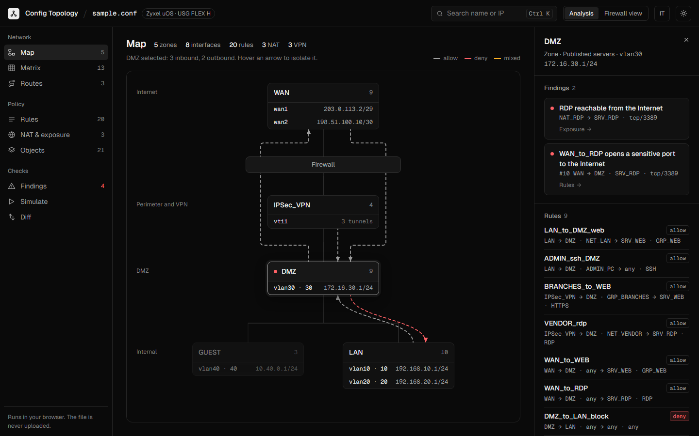

# Config Explorer for Zyxel uOS

See what's inside a Zyxel uOS firewall configuration at a glance.

**Use it online: https://rainpwn.github.io/zyxel-config-explorer/.** Nothing to install, and your file never leaves your browser (see [Can I trust it with my config?](#can-i-trust-it-with-my-config)).



## Why

Sooner or later someone hands you a firewall you didn't set up. It might be a new customer, a site a colleague used to look after, or a config posted on the forum by someone who needs help. Before you change anything, you want the basics:

- Which zones, VLANs and subnets are there?
- Where is traffic allowed to go?
- What can be reached from the Internet?
- Which tunnels exist?
- Is anything contradicting itself?

On a USG FLEX H, the two places to look don't make that easy:

- **The web interface** shows each section on its own page: security policies, objects, NAT, VPN, routing. You build the picture in your head by clicking back and forth.
- **The exported `.conf`** has everything, one setting per line. A real config with 190 rules and 127 VPN tunnels runs to about 17,700 lines.

As far as I know, there is no native tool that turns a uOS configuration into an overview. Config Explorer does that. Drop the `.conf` on the page and you get:

- a map of the zones by trust level, with their interfaces and subnets;
- the traffic each zone sends and receives;
- a list of things worth a second look, such as RDP published to the Internet, rules that can never match, or NAT rules with no allow rule behind them.

From there you drill into the rules, routes, objects and NAT, and every finding links to the lines that cause it.

It's meant for a first read, or a quick sanity check. It does not replace the device's own interface.

## Can I trust it with my config?

You shouldn't have to take our word for it. A uOS `.conf` holds secrets: a real one we tested had 126 VPN pre-shared keys, 36 passwords or password hashes and an SNMP community. So the app is built to make leaking them impossible, and every point below can be checked without reading any code.

1. **Pull the plug.** Open the page, then disconnect from the network (Wi-Fi off, cable out), then drop your file. The map, rules and findings all work, because the app needs nothing from the network once the page has loaded. Something that works offline has nowhere to send your data.
2. **Watch the traffic.** Open the browser's developer tools on the Network tab, then drop a file. No request appears.
3. **The browser blocks it anyway.** The published page carries a Content-Security-Policy, visible with "View page source". It lets the page load only its own files and blocks every connection to any other host, including `fetch`, images and beacons. If a malicious or careless script ever got in, the browser would still refuse to send anything out.
4. **Secrets are never read.** The parser (`src/parser/uos.ts`) only picks up the settings it knows: zones, interfaces, objects, rules, NAT, routes, VPN endpoints. Keys and passwords are skipped, and a test (`src/parser/uos.test.ts`) fails if a pre-shared key ever ends up in the parsed result. Only that parsed result is kept in your browser's local storage, so the config survives a reload. "Close and remove" in the file menu clears it.
5. **What runs is what you can read.** The site is built and published by a public GitHub Actions workflow (`.github/workflows/pages.yml`) from this repository. No other code is involved, and the build logs are public.

**Still not comfortable?** Two more options:

- **Strip the secrets before you load the file.** Since the app never reads them, the analysis is exactly the same: we checked byte for byte on a real config.

  ```sh
  # Linux / macOS
  grep -viE 'pre-shared-key|"psk"|"password"|"secret"|"community"|private-key|passphrase' backup.conf > clean.conf
  ```

  ```powershell
  # Windows PowerShell
  Select-String -Path backup.conf -NotMatch -Pattern 'pre-shared-key|"psk"|"password"|"secret"|"community"|private-key|passphrase' | ForEach-Object Line | Set-Content clean.conf
  ```

- **Run your own copy.** Follow [Run it locally](#run-it-locally) and the file never even meets our website.


## Run it locally

```sh
npm install
npm run dev
```

Open http://localhost:5173. Drop a `.conf` file exported from the firewall onto the page, or click the button that loads the bundled sample. `public/sample.conf` is synthetic: no real network is behind it.

To build a static copy you can serve from any web server (including one on an offline machine, e.g. `npx vite preview` or `python -m http.server` inside `dist/`):

```sh
npm run build   # output in dist/
```

## What it shows

| View | Content |
|---|---|
| Map | The landing view. Zones grouped by trust level, with their interfaces, VLANs and subnets, plus a one-line inventory. Select a zone to see where its traffic is allowed to go, or an interface to narrow it to that subnet. |
| Rules | Security policies in evaluation order, with search and filters. Hovering an object shows what it resolves to. |
| Routes | Policy routes in evaluation order, with their next hop (IPsec tunnel, trunk or interface). |
| Objects | Address and service objects and groups, with how often each is referenced. Exports to CSV. |
| Matrix | Zone-to-zone grid with allow and deny counts. Click a cell to open its rules. |
| Simulate | Source IP, destination IP and protocol/port in, first matching rule and egress route out. |
| Exposure | NAT virtual servers and WAN allow rules, with the ports they open. Exports to CSV. |
| Findings | Everything worth a look, sorted by severity: sensitive services reachable from the WAN, NAT rules with no allow rule behind them, conflicting or redundant rules, unused objects. Each one links to its evidence. |
| Diff | Changes between two versions of the configuration. |

From the map's side panel you can also mark an interface or a VPN tunnel as down and see which routes, NAT rules and zones are affected. `Ctrl+K` opens a search across zones, objects, rules and IP addresses. The file menu (click the file name) opens a printable report with the full configuration.

A second mode, Firewall view, lays out the same data in tables shaped like the uOS web interface, for people who already know their way around the device. It is read-only.

## Limits

The analysis works on the configuration text alone. It cannot know the live state of the device.

- The simulator treats every user and schedule as "any" and does not apply NAT. The result lists these assumptions.
- FQDN and geography objects have no IP range, so they cannot be matched against an IP.
- Only the IPv4 settings the parser recognises are used. Anything else in the file is ignored.
- Developed against a USG FLEX 700H configuration. Other uOS models and firmware versions may use settings the parser does not know yet. If something is missing or wrong, an issue with the affected (anonymised) lines helps a lot.

## Development

```sh
npm test            # vitest
npx tsc --noEmit    # typecheck
```

The code is a client-only React + TypeScript app built with Vite, with no runtime dependencies beyond React.

- `src/parser/uos.ts` parses the uOS line format into the model in `src/model.ts`.
- `src/derive.ts` contains IPv4 range arithmetic, object and group resolution, and zone lookups.
- `src/analysis.ts` contains the simulator, failure impact, shadowed rules, orphan objects, WAN exposure and diff.
- `src/views/` has one component per sidebar view; `src/fw/` contains the Firewall view.

Tests use synthetic fixtures in the real uOS line format. Please don't commit real configuration files: `*.conf` is git-ignored for that reason.

## License

MIT
